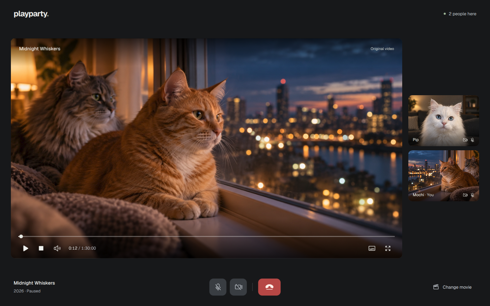

# Playparty

**Playparty has no built-in authentication by design.** It is meant to be used through private URLs and/or a VPN.

A movie and a video call for you and your friends. Open one URL, enter your name, and join. The host picks what plays; playback stays synchronized and everyone chooses their own subtitles.

Remote streams adjust to the connection. Local playback keeps the highest compatible quality, and your other Plex apps keep their existing settings.



## Install

You need **macOS or Linux (x64 or arm64)**, **Node.js 22.14+**, npm, Git, and a running **Plex Media Server** with your libraries. New to Plex? Start with [Plex's quick-start guide](https://support.plex.tv/articles/200264746-quick-start-step-by-step-guides/). On macOS, install [Homebrew](https://brew.sh) first.

```sh
git clone https://github.com/ilyador/playparty.git
cd playparty
npm ci
npm run setup
npm start
```

Setup asks for your Playparty address, Plex server address, and a [Plex token](https://support.plex.tv/articles/204059436-finding-an-authentication-token-x-plex-token/) with library access. Linux can also use a readable Plex `Preferences.xml`. Setup checks access, installs LiveKit for the call, and saves private configuration.

For a local trial, accept `http://localhost:5175` and open it in your browser. When Playparty can reach the configured Plex server from its machine, **I am the host** appears: turn it on and join. The switch stays hidden when Plex is unavailable. No Plex sign-in or email check is needed; friends enter only their name.

An active hosted party disables the host switch for other visitors. Empty parties clear automatically when everyone leaves; brief disconnects keep a 45-second window to reconnect.

Keep `npm start` running while watching. Ctrl+C stops the app and call server. Setup preserves existing configuration; edit `.env` to change it.

## Share with friends

Camera and microphone access outside localhost requires **HTTPS**. Give setup your HTTPS address, point its DNS record at your server, and use an HTTPS reverse proxy. With [Caddy](https://caddyserver.com/docs/install):

```caddyfile
playparty.example.com {
    reverse_proxy 127.0.0.1:5175
}
```

Forward these router ports to the server and allow them in its firewall:

- **443/TCP** for HTTPS and call signaling.
- **7882/UDP** for camera and microphone media.
- **7881/TCP** for call fallback when UDP is unavailable.

Caddy may also need **80/TCP** for certificates and redirects. Restart Playparty after setting up the forwards, then send friends your HTTPS URL. Anyone with the URL can join and choose to host while Plex is available. To restrict host and library access, use an [existing authentication provider](docs/setup.md#existing-authentication-provider).

[Setup details, settings, updates, and troubleshooting](docs/setup.md)
